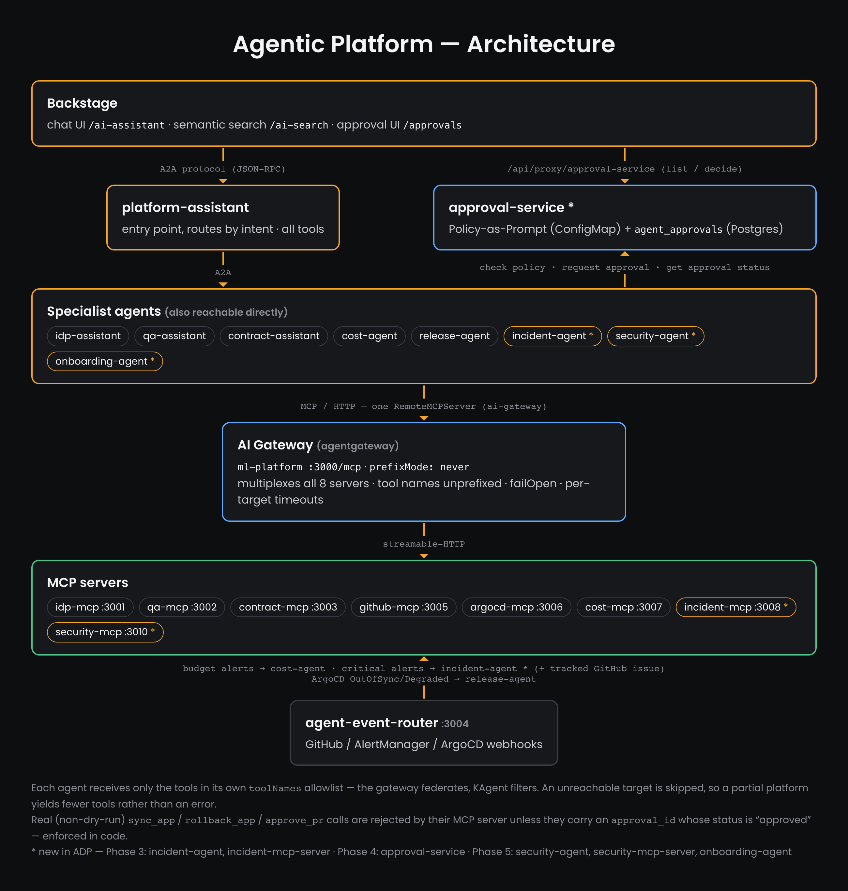

# Agentic Development Platform (ADP)

ADP turns the AI layer ([AI Assistant](ai-assistant.md)) from a chat assistant
into agents that act across the developer workflow (scaffold, test, review) and
platform operations (cost, incidents, releases, security), behind a
human-in-the-loop approval gate. It's opt-in:

```bash
./scripts/bootstrap-ai.sh --adp          # local
./scripts/bootstrap.sh --adp             # AWS (implies --with-ai)
```

Without `--adp`, the base AI stack is unchanged.



## What you get

| Capability | Agent / component | Where |
|---|---|---|
| PR review against the shift-left and contract-testing checklists; `approve_pr` / `request_changes` | `qa-assistant` + `github-mcp-server` | `kubernetes/kagent/qa-agent.yaml` |
| Release ops: sync and roll back ArgoCD apps | `release-agent` + `argocd-mcp-server` | `kubernetes/kagent/release-agent.yaml` |
| Cost: budget alerts → analysis | `cost-agent` + `cost-mcp-server` | `kubernetes/kagent/cost-agent.yaml` |
| Incidents: open incidents, alert history, runbooks, updates | `incident-agent` + `incident-mcp-server` | `kubernetes/kagent/incident-agent.yaml` |
| Security: Dependabot alerts, secret-rotation status, Kyverno violations (read-only) | `security-agent` + `security-mcp-server` | `kubernetes/kagent/security-agent.yaml` |
| Onboarding: catalog and docs answers | `onboarding-agent` (reuses `idp-mcp-server`) | `kubernetes/kagent/onboarding-agent.yaml` |
| Event-driven triggers: GitHub, Alertmanager and ArgoCD webhooks routed to the right agent | `agent-event-router` | `services/agent-event-router/src/router.ts` |
| **Approval gate** for mutating actions, with an `/approvals` page in Backstage | `approval-service` | [Agent Approvals](agent-approvals.md) |

The gate is enforced in the tool servers, not only in prompts: `sync_app`,
`rollback_app` and `approve_pr` refuse a real call without an approved
`approval_id`. Which actions need approval is set in
`kubernetes/kagent/policies/configmap.yaml` (by default `rollback_app` always,
`sync_app` on `prod-*` apps). Every decision is written to the audit log.

## KAgent or LangGraph

Both are available and they don't compete:

| | KAgent | LangGraph |
|---|---|---|
| Defined as | Kubernetes resources (`kind: Agent`) | Application code you own |
| Owned by | The platform team | The service team |
| Reach for it when | A prompt plus tools is enough | The agent must loop, branch, or hold state |

Both use the same eight MCP servers and trace to the same Langfuse. The
`langgraph-agent` template propagates `traceparent` on every MCP call, so a run
shows up as one nested trace. Reasoning: [ADR-0005](design/adr-0005-llm-serving-and-agent-frameworks.md).

## See also

- [AI Assistant](ai-assistant.md) — agent and MCP server reference
- [Agent Approvals](agent-approvals.md) — policy rules, approval API, UI
- [KAgent guardrails](runbooks/kagent-guardrails.md)
