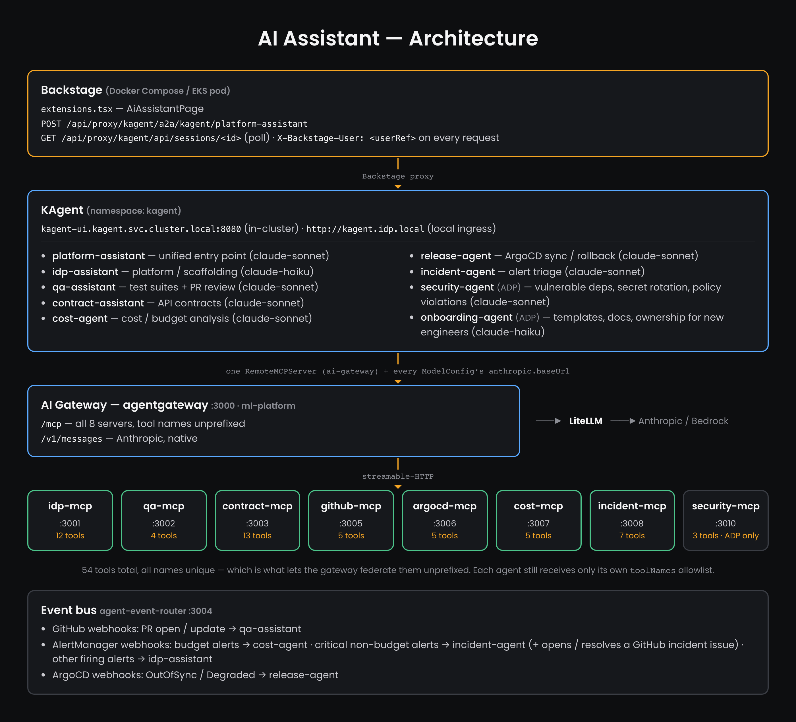

# AI Assistant

A chat assistant in the Backstage portal (`/ai-assistant`), backed by
[KAgent](https://kagent.dev) agents with live access to the catalog, metrics,
deployments, the scaffolder, test suites, contracts, GitHub, cost data and ArgoCD.
The [Agentic Development Platform](agentic-platform.md) builds on it.

```bash
./scripts/bootstrap-ai.sh          # local
./scripts/bootstrap.sh --with-ai   # AWS
```

Requires `ANTHROPIC_API_KEY` (or see [self-hosted models](#self-hosted-models-no-api-key)).



## Using it

**In Backstage**, open **AI Assistant** and pick a suggestion chip or type a
request, e.g. *"scaffold a Python FastAPI service called demo-svc, owner
group:default/qa-platform-team"*. The agent calls `list_templates` →
`get_template_params` → `scaffold_service` in one turn and replies with the task
link. Say *"dry run"* or *"preview"* to see what would be created without creating it.

Your identity travels as `X-Backstage-User`, set server-side from your session; the
model never sees or controls it. Per-user preferences (team, language, owner) are
remembered between sessions.

**From the terminal:**

```bash
idp ai "what services are owned by team-qa?"
idp ai --timeout 60 "show me the error rate for hello-service"
KAGENT_URL=http://my-cluster.example.com idp ai "list deployments"
```

By default `idp ai` talks to KAgent with no identity, so memory isn't tied to you
and it prints a warning. To act as you, export `IDP_BACKSTAGE_USER_TOKEN` (a
Backstage **user** token, ~1 h); calls then go through
`/api/idp-ai-identity/…`, the same route the portal uses. To get one, run this in
the devtools console of a signed-in Backstage tab (`env=production` on AWS):

```js
(await (await fetch('/api/auth/github/refresh?optional&env=development', {
  headers: { 'X-Requested-With': 'XMLHttpRequest' }, credentials: 'include',
})).json()).backstageIdentity.token
```

## Agents

`platform-assistant` (`kubernetes/kagent/platform-agent.yaml`) is the entry point
for the portal and the CLI and routes by intent. Specialists are reachable at
`/a2a/kagent/<name>`:

| Agent | Model | Purpose | Installed |
|---|---|---|---|
| `platform-assistant` | Sonnet | Everything: catalog, scaffolding, metrics, QA, contracts, memory | default |
| `idp-assistant` | Haiku | Platform and scaffolding | default |
| `qa-assistant` | Sonnet | Test suites, PR review | default |
| `contract-assistant` | Sonnet | API contracts — see [Contract Testing](contract-testing.md) | default |
| `cost-agent` | Sonnet | Cost and budgets; also triggered by budget alerts | default |
| `release-agent` | Sonnet | ArgoCD sync and rollback; also triggered by OutOfSync/Degraded | default |
| `incident-agent` | Sonnet | Alert triage; triggered by critical alerts | `--agents all` |
| `security-agent` | Sonnet | Read-only: vulnerable deps, secret rotation, policy violations | `--agents all` |
| `onboarding-agent` | Haiku | Template, catalog and docs discovery | `--agents all` |
| `provisioning-agent` | Sonnet | Turns a resource request into a golden-path template, shows the cost and team budget, and submits it for human approval — see [Agent Approvals](agent-approvals.md#scaffolding-through-an-agent) | `--agents all` |

```bash
./scripts/bootstrap-ai.sh --agents all          # all ten
./scripts/bootstrap-ai.sh --agents idp,security # a subset (re-running prunes the rest)
./scripts/bootstrap-ai.sh --agents list
```

Each agent is one pod — see [Local Setup](local-setup.md#machine-requirements-and-what-to-do-if-you-dont-have-them).
Every agent's system prompt forbids `ask_user` and interactive confirmation tools
(the portal can't render them and the turn would hang); add the same rule to any
new agent.

**Prompts** live as `spec.systemMessage` on each Agent CRD in `kubernetes/kagent/`,
versioned in Git. `scripts/sync-agent-prompts.py --push` mirrors them to Langfuse
for review; `--check` and `--check-evals` fail CI when Langfuse or the DeepEval
copy drifts from the CRD.

## Models

| ModelConfig | Model | Notes |
|---|---|---|
| `claude-anthropic` | Claude Haiku | Fast, cheap |
| `claude-sonnet` | Claude Sonnet | Default for most agents |
| `claude-opus` | Claude Opus | Available for new agents |
| `openai-prod` | GPT-4o | Set `OPENAI_API_KEY` |
| `ollama-local` | `qwen2.5:1.5b` | Only with `--ollama` |

Every ModelConfig points at the AI Gateway, which forwards model calls to
**LiteLLM** (`kubernetes/ml-platform/litellm.yaml`). LiteLLM holds the provider
keys (and Bedrock credentials on AWS) and adds virtual keys and spend tracking,
shown on the **LiteLLM Spend** page. It's on by default; with `--skip-litellm`
tools still work but model calls fail. See
[ADR-0007](design/adr-0007-ai-gateway.md) and [ADR-0008](design/adr-0008-litellm-multiprovider-gateway.md).

### Self-hosted models (no API key)

```bash
./scripts/bootstrap-ai.sh --ollama            # local (~1.5 GB resident)
./scripts/bootstrap-ai.sh --aws --ollama      # AWS
```

Deploys one shared Ollama in `ml-platform` plus the `ollama-local` ModelConfig. No
agent is repointed at it: a 1.5B model can't drive multi-tool loops. Repoint one
low-stakes agent's `modelConfig` to try it.

The **Model Serving API** template scaffolds your own server: `mock` (canned
OpenAI-shaped replies, the local default), `ollama` (CPU; locally needs
`IDP_ALLOW_LOCAL_OLLAMA=true`), or `vllm` (needs a GPU node, otherwise it fails fast).

## MCP servers

All eight sit behind one AI Gateway (`kubernetes/ml-platform/ai-gateway.yaml`).
Tool names are not prefixed, so each must be unique across servers —
`scripts/validate-mcp-tool-names.py` guards that.

| Server | Key tools | Used by |
|---|---|---|
| `idp-mcp-server` | `catalog_search`, `catalog_semantic_search`, `get_service_metrics`, `list_templates`, `get_template_params`, `scaffold_service`, `list_deployments`, `get_core4_report`, `get_user_memory`, `set_user_memory`, approval tools | platform, idp, onboarding |
| `qa-mcp-server` | `list_test_suites`, `scaffold_test_suite`, `search_test_catalog`, `get_test_metrics` | platform, qa |
| `contract-mcp-server` | `fetch_service_contract`, `register_contract`, `generate_contract_tests`, `detect_breaking_changes`, … | contract |
| `github-mcp-server` | `get_pr_diff`, `add_pr_comment`, `get_ci_status`, `approve_pr`, `request_changes` | qa |
| `argocd-mcp-server` | `list_apps`, `get_app_health`, `get_app_diff`, `sync_app`, `rollback_app` | release |
| `cost-mcp-server` | `get_namespace_cost`, `get_team_spend`, `list_budget_overruns`, `get_rightsizing_recommendations`, `forecast_budget` | cost |
| `incident-mcp-server` | `get_open_incidents`, `get_alert_history`, `get_runbook`, `post_incident_update`, `send_notification` | incident |
| `security-mcp-server` | `list_vulnerable_deps`, `get_secret_rotation_status`, `list_policy_violations` | security |

Mutating tools (`sync_app`, `rollback_app`, `approve_pr`) default to `dry_run: true`
and need an approved `approval_id` for a real call — see [Agent Approvals](agent-approvals.md).
The ArgoCD token belongs to a dedicated `argocd-mcp` account limited to get, sync
and actions.

## Event-driven agents

`agent-event-router` (`services/agent-event-router/`) receives webhooks and
dispatches agents without a human starting the conversation:

| Source | Trigger | Agent |
|---|---|---|
| GitHub | PR opened/updated | `qa-assistant` reviews and comments |
| Alertmanager | Budget alert | `cost-agent` |
| Alertmanager | Critical, non-budget | `incident-agent` (a GitHub incident issue is opened first, closed on resolve) |
| Alertmanager | Other severities | `idp-assistant` |
| ArgoCD | App OutOfSync / Degraded | `release-agent` proposes sync or rollback (dry-run first) |

GitHub webhooks are HMAC-verified (fails closed without `GITHUB_WEBHOOK_SECRET`);
Alertmanager and ArgoCD need `Authorization: Bearer <WEBHOOK_TOKEN>`.

## Guardrails and audit

- **Audit log:** every mutating tool call emits an `[AUDIT]` JSON line with
  server, action, agent and arguments; approval decisions are logged by
  `approval-service`. Query in Loki: `{app="idp-mcp-server"} |= "[AUDIT]" | json`.
- **Metrics:** `mcp_agent_tool_calls_total{server,tool,agent}` and
  `mcp_tool_calls_total{outcome}`, on the **AI Platform** Grafana dashboard.
- **Alerts:** `ScaffoldServiceHighRate` (>5 scaffolds in 10 min) and
  `McpToolErrorRateHigh` (>50% errors) — see the [KAgent Guardrails runbook](runbooks/kagent-guardrails.md).
- **Prompt rules:** announce state-changing actions, support dry runs, and pause
  after three scaffolds in one session.

## LLM observability (Langfuse)

Langfuse records what the model actually did: prompts, completions, tokens, cost,
latency, and the tool calls inside each run. It's on by default (6 pods, ~2.4 GiB
— see [Local Setup](local-setup.md#adding-it-up)); `--skip-langfuse` turns it off.

Open **AI Observability** in Backstage or <http://langfuse.idp.local>. The admin
password:

```bash
kubectl get secret langfuse-init -n ml-platform \
  -o jsonpath='{.data.LANGFUSE_INIT_USER_PASSWORD}' | base64 -d
```

**Where traces come from:** KAgent exports OTLP for agent LLM calls, and each MCP
server wraps its tools in spans tagged with the agent and the Backstage user.
Input/output capture is **off** by default (`LANGFUSE_CAPTURE_IO`) because tool
payloads can carry PII.

> **Gotcha:** the OTLP protocol must be the exact string `http/protobuf`. Anything
> else (including `"http"`) silently falls back to gRPC and every span is dropped.

**Your own service:** use the **Enable Langfuse LLM Tracing** template (existing
service) or **LLM App (Python + Langfuse)** (new one). Credentials reach a
namespace by label:

```bash
kubectl label namespace <ns> idp.io/langfuse=enabled
./scripts/bootstrap-ai.sh --langfuse-keys-only   # copies the keys; deploys nothing
```

`services-dev` is labelled automatically. Restart running workloads afterwards.
A component with the `langfuse.com/service-name` annotation gets a **Langfuse**
tab; keep it equal to `OTEL_SERVICE_NAME`.

**Cost shows $0.00:** Langfuse's built-in price table is frozen at the chart's
release. `bootstrap-ai.sh` seeds newer models (`_seed_langfuse_model_prices`);
pricing applies only to traces ingested afterwards.

## AI Search

`/ai-search` does semantic search over the catalog and rendered TechDocs pages
using [Voyage AI](https://www.voyageai.com) embeddings in pgvector (the Backstage
Postgres itself). Add `VOYAGE_API_KEY` to `local/backstage/.env` (free tier is
plenty); without it every search returns 503.

The index refreshes every 30 minutes (`ragSearch.indexIntervalMinutes`). A docs
page is indexed only after its TechDocs site has been built once. Re-index now
with `curl -X POST http://backstage.idp.local/api/rag-search/index`; check
`/api/rag-search/status`.

## MLflow page

`/mlflow` shows experiments, runs and registered models from the MLflow 2.x API,
so `mlflow-experiment` and `idp:run-training-job` output is visible in the portal.
It shows demo data when the AI stack isn't installed, and a red banner naming the
failing endpoint when MLflow is installed but unreachable.

## Where the AI pages come from (and why they're hidden)

AI Assistant, AI Search, Agent Approvals, KAgent, MLflow and the other AI pages are
disabled until the stack behind them exists. `bootstrap-ai.sh` turns them on in the
generated `local/backstage/app-config.ai.yaml` (`--destroy` turns them off);
`app-config.aws.yaml` enables them on AWS. One helper, `write_backstage_ai_overlay`
in `scripts/lib.sh`, writes the list.

- **Restart Backstage to see them:** config is read only at startup
  (`./scripts/bootstrap-local.sh --start-backstage`).
- **`app.extensions` arrays replace, they don't merge.** The overlay repeats every
  entry from earlier layers; anything added to `app-config.yaml`'s list must also be
  added to the helper, including the non-AI `page:kubernetes: disabled` entry.
- The file is generated and gitignored; hand edits are lost.

## Troubleshooting

| Symptom | Fix |
|---|---|
| An AI page is missing from the sidebar | Run `./scripts/bootstrap-ai.sh`, then `--start-backstage`. If `app-config.ai.yaml` doesn't exist, run either bootstrap script to generate it |
| "AI assistant did not respond (no session created)" | `kubectl get po -n kagent`; `curl http://kagent.idp.local/api/sessions` |
| "No description available" on agent tools | A tool in the agent's `toolNames` isn't served by any healthy gateway target. Check `kubectl logs -n ml-platform deploy/ai-gateway` and <http://ai-gateway.idp.local/ui> |
| "No metrics found for …" | The service has no `ServiceMonitor`, or Prometheus hasn't discovered it (`http://prometheus.idp.local/targets`) |
| AI Search returns 503 | `VOYAGE_API_KEY` missing; add it and restart Backstage |
| AI Observability shows no data | Work outwards: Langfuse pods (`-l app.kubernetes.io/instance=langfuse`), then the project keys directly, then through `/api/proxy/langfuse` |
| `401` from Langfuse via Backstage | `LANGFUSE_BASIC_AUTH` must be listed under `environment:` in `local/backstage/docker-compose.yml` |
| `504` naming `backstage.idp.local` | `langfuse.idp.local` is missing from the compose file's `extra_hosts` |

To redeploy one MCP server after a code change:

```bash
cd services/<server> && docker build -t localhost:5003/<server>:0.1.0 . && docker push localhost:5003/<server>:0.1.0
kubectl rollout restart deployment/<server> -n services-dev
```
