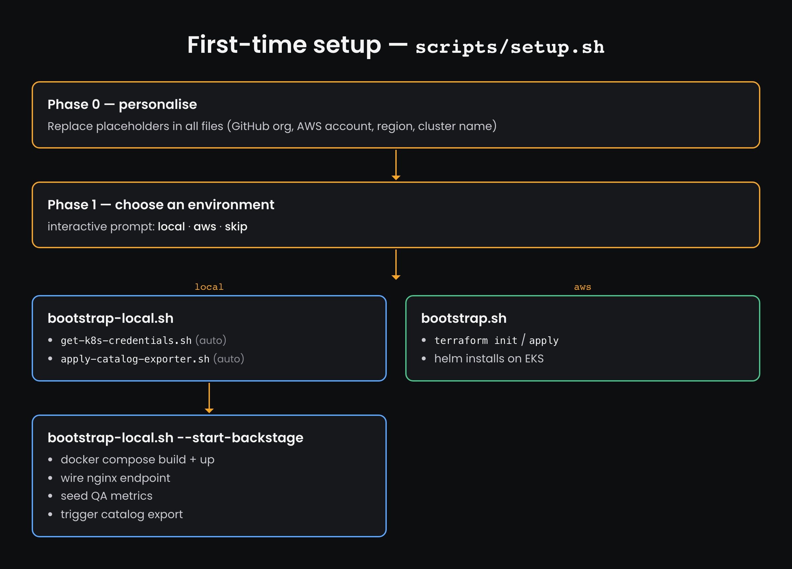

# Scripts Reference

Every script under `scripts/`. For the `idp` CLI, see [CLI Reference](cli-reference.md).

## Prerequisites

| Path | Required tools |
|---|---|
| **Local (Kind)** | `git`, `docker`, `kind` ≥ 0.27, `kubectl`, `helm` ≥ 3.14 |
| **AWS** | The above, plus a configured `aws` CLI, `terraform` ≥ 1.5, `jq` |
| Auto-installed if missing | `go` ≥ 1.26 (for the `idp` CLI), Node.js 24 (for Backstage) |

Each script runs a preflight check before doing anything destructive. Walkthroughs:
[Local Setup](local-setup.md#prerequisites), [Pre-Deployment Checklist](PRE_DEPLOYMENT_CHECKLIST.md#what-you-need-before-deploying).

## `setup.sh` vs `bootstrap-local.sh`

- **`setup.sh`** runs **once**. It replaces the template placeholders with your
  values, creates the `.env` files, builds the `idp` CLI, then asks *local / aws /
  skip* and calls the right bootstrap script.
- **`bootstrap-local.sh`** installs the platform on Kind or Rancher Desktop. It's
  what you use for **day-2** work (`--destroy`, `--start-backstage`, recreating the cluster).

On a fresh clone, run `setup.sh` and nothing else. Running both back to back just
repeats a 15–20 minute install. Personalisation has to come first, or ArgoCD,
the catalog and ingress hostnames point at unresolved placeholders.

## Quick reference

| Script | What it does | When |
|---|---|---|
| `setup.sh` | Personalise, create `.env` files, bootstrap local or AWS | Once |
| `bootstrap-local.sh` | Create or recreate the Kind cluster and platform | Day-2 local |
| `bootstrap-ai.sh` | Add the AI/ML stack to a running cluster (`--aws` for EKS) | After the core bootstrap |
| `bootstrap.sh` | AWS: Terraform → EKS → platform (~40–70 min); AI with `--with-ai` | AWS |
| `verify-secrets.sh` | Check every required secret and key before an AWS deploy | Before `bootstrap.sh` |
| `validate-deployment.sh` | 50+ checks across infra, Kubernetes, Backstage, observability, GitOps, AI, security | After `bootstrap.sh` |
| `cleanup.sh` | Ordered AWS teardown that also removes what Terraform doesn't own — see [why](DEPLOYMENT_GUIDE.md#what-terraform-owns-and-what-it-cannot-destroy). `--force` skips prompts | Tearing down AWS |
| `recover-docker-restart.sh` | Fix Kind after Docker shuffles container IPs (`--skip-backstage`, `--dry-run`). See [Kind Node IP Mismatch](runbooks/kind-node-ip-mismatch.md) | After a Docker restart |
| `verify-engineering-intelligence.sh` | Check the Engineering Intelligence layer against real Backstage + Postgres without a cluster (~2 min). `--screenshot`, `--keep` | After changing EI code |
| `get-k8s-credentials.sh` | Create Backstage's service account and write `K8S_*` to `local/backstage/.env` | Called by `bootstrap-local.sh` |
| `apply-catalog-exporter.sh` | Deploy the catalog exporter CronJob | Called by `bootstrap-local.sh` |
| `setup-runner.sh` | Start a GitHub Actions self-hosted runner that deploys to the local cluster | After creating a service repo |

### `bootstrap-local.sh` flags

| Flag | What it does |
|---|---|
| `--full` | Cluster, platform and Backstage in one go |
| `--start-backstage` | Build and start Backstage, wire nginx, seed metrics |
| `--print-urls` | Print every platform URL and exit |
| `--provider <name>` | `kind` (default) or `rancher-desktop` |
| `--update-backstage-ip` | Re-point the ingress at Backstage's current container IP |
| `--install-argocd` | Install or repair ArgoCD and register GitHub credentials |
| `--install-pushgateway` | Install or repair the Pushgateway and seed QA metrics |
| `--install-argo-workflows` | Install Argo Workflows |
| `--skip-obs` / `--skip-policies` / `--skip-gitops` / `--skip-dora` | Skip observability / Gatekeeper + Kyverno / ArgoCD / the DORA exporter |
| `--destroy` | Remove scaffolded services, delete the cluster, stop Backstage. Keeps the registry and Docker caches so the next bootstrap is fast |
| `--clean-docker` | Reclaim disk: remove the registry, all unused images and volumes, and the buildx cache. The next cold bootstrap then takes ~19 min instead of ~6 |

### `bootstrap.sh` flags

| Flag | What it does |
|---|---|
| `--profile <small\|medium\|large\|none>` | Layer `terraform/profiles/<p>.tfvars`. `medium`/`large`: one NAT per AZ, RDS Multi-AZ, VPC endpoints, HA ArgoCD, two zone-spread Backstage replicas ([ADR-0009](design/adr-0009-single-region-multi-az.md)). Remembered in `terraform/.idp-profile`; `none` clears it |
| `--with-ai` | Install the AI/ML stack (runs `bootstrap-ai.sh --aws`) |
| `--adp` | Implies `--with-ai`; adds the Agentic Development Platform |
| `--remove-ai-infra` | Destroy existing AI infrastructure (Langfuse RDS and its data, S3, IRSA). Never implied by omitting `--with-ai` |
| `--cluster-name <name>` / `--region <region>` | Target cluster and region |
| `--skip-velero` | Skip Velero backups (leaves no restore path) |
| `--skip-gitops` / `--skip-policies` / `--skip-dora` | As for `bootstrap-local.sh` |
| `--skip-ai` | Deprecated no-op |

### `bootstrap-ai.sh` flags

The authoritative list; other pages defer to it.

| Flag | Default | What it does |
|---|---|---|
| `--agents <list>` | `idp,qa,release,cost,platform,contract` | Agents to install (one pod each). `all` adds `incident`, `security`, `onboarding`, `provisioning`; `none` installs only the runtime and UI; `list` prints them. Re-running **prunes** the rest. See [Local Setup](local-setup.md#machine-requirements-and-what-to-do-if-you-dont-have-them) |
| `--adp` | off | Add the [Agentic Development Platform](agentic-platform.md) and its approval gate |
| `--ollama` | off | Deploy a local Ollama model so agents can run without `ANTHROPIC_API_KEY` |
| `--skip-gateway` | — | Skip the AI Gateway. Agents then have **no tools and no model**; only for debugging MCP servers ([ADR-0007](design/adr-0007-ai-gateway.md)) |
| `--skip-litellm` | — | Skip LiteLLM. Tools still work; every model call fails ([ADR-0008](design/adr-0008-litellm-multiprovider-gateway.md)). Needs `LITELLM_MASTER_KEY` when on (generated locally) |
| `--skip-langfuse` | — | Skip Langfuse tracing (saves ~2 GB and 6 pods) |
| `--langfuse-keys-only` | — | Copy Langfuse keys to namespaces labelled `idp.io/langfuse=enabled`; deploy nothing |
| `--skip-mlflow` / `--skip-mcp` / `--skip-kagent` | — | Skip MLflow / the MCP servers / KAgent |
| `--skip-argo-workflows` | — | Skip Argo Workflows (~5 min). `idp:run-training-job` falls back to a plain Job, without the accuracy gate or approval step ([ADR-0001](design/adr-0001-batch-orchestration.md)) |
| `--force-build` | off | Rebuild MCP server images and releases even when unchanged |
| `--aws` | off | Target EKS instead of Kind (`bootstrap.sh` passes it for you) |
| `--cluster <name>` / `--region <region>` | from `.idp-config.env` | AWS target |
| `--destroy` | — | Remove the AI stack, hide the AI pages, restart Backstage |

`--gateway`, `--litellm` and `--langfuse` also exist but only force on what is
already the default.

### Helper scripts

| Script | What it is |
|---|---|
| `lib.sh` | Shared bash library: logging, `HELM_WAIT_*`, preflight, retry/skip helpers, scaffolded-service cleanup |
| `render-backstage-config.py` | Renders the Backstage config layer for an environment |
| `render-postmortem.py` | Drafts a post-mortem from an incident issue |
| `render-template.cjs` | Renders a scaffolder template offline: `node scripts/render-template.cjs backstage/catalog/templates <name> - /tmp/out` |
| `sync-agent-prompts.py` | Mirrors agent prompts to Langfuse; fails CI on drift |
| `sync-mcp-common.sh` | Copies `services/mcp-common/src/` into every MCP server; `--check` is the CI drift gate |
| `validate-catalog-templates.py` | CI: every template is registered and parses |
| `validate-platform-outputs.py` | CI: renders every template that opens a PR here and validates the output (Terraform, claims, kubeconform, chart, Gatekeeper) |
| `validate-mcp-metrics.py` | CI: dashboards and alerts only select labels the MCP servers emit |
| `validate-mcp-tool-names.py` | CI: tool names are unique across MCP servers (the gateway doesn't prefix them) |

## Re-running the bootstrap scripts — caching and parallelism {#re-running-the-bootstrap-scripts-caching-and-parallelism}

All three bootstrap scripts are safe to re-run. They skip work that is provably
unchanged and run independent work in parallel:

- **Helm releases** are skipped when the chart, version, `--set` values and values
  file *contents* are unchanged and the release is `deployed`.
- **Image builds** are skipped when the source hash is unchanged and the tag still
  exists in the registry or ECR. Builds run in the background while the rest installs.
- Fingerprints live in `.idp-cache/`, but every skip is also checked against live
  cluster state, so deleting it only costs time.

| Variable | Default | Effect |
|---|---|---|
| `IDP_FORCE` | `0` | `1` disables every skip |
| `IDP_BUILD_JOBS` | `ncpu/3` (1–4) | Concurrent MCP image builds in `bootstrap-ai.sh` |
| `IDP_HELM_REPO_TTL` | `3600` | Seconds before chart repo indexes are refreshed |
| `IDP_TIMING` | `1` | Per-step timings and a slowest-first summary, printed even on failure |
| `HELM_WAIT_SHORT` / `_MED` / `_LONG` / `_XL` | `5m` / `10m` / `15m` / `25m` | `helm --wait` budgets. On a slow link, raise these — a chart still pulling images hasn't failed |

On Apple Silicon, AWS images are built for `linux/amd64` under emulation, so the
Backstage image is the slowest step of a cold AWS bootstrap. `docker buildx` keeps
a layer cache in ECR, so rebuilds only redo changed stages.

## Execution flow



Per new service or test suite (day-2):

```bash
idp scaffold service --name my-svc --type nodejs            # via Backstage when running
idp scaffold service --name my-svc --type nodejs --local    # offline
idp scaffold test-suite --name my-e2e --type playwright --service my-svc
scripts/setup-runner.sh --repo my-svc
```
